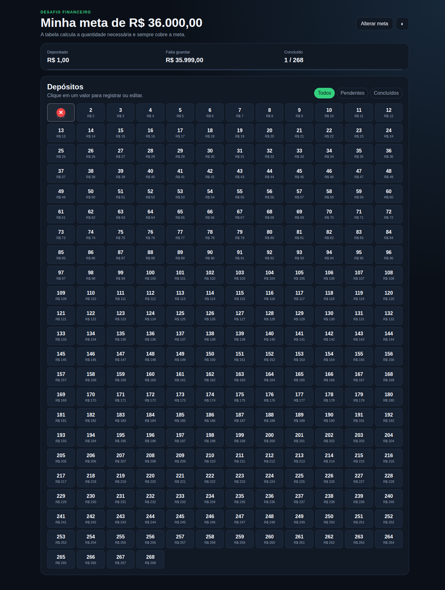
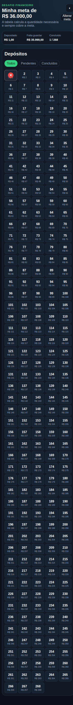

# Calendário Invest

Aplicativo web para transformar uma meta financeira em uma sequência visual
de depósitos. A pessoa define o objetivo, e o sistema calcula a menor tabela
sequencial cuja soma alcança ou ultrapassa o valor informado.

## Funcionalidades

- Cria, seleciona, edita e remove várias metas financeiras.
- Cadastra os bancos usados nos depósitos.
- Calcula automaticamente a quantidade de depósitos necessários.
- Registra, edita e remove depósitos separados por meta e banco.
- Exibe o total depositado, o valor restante e o progresso.
- Filtra os itens entre todos, pendentes e concluídos.
- Alterna entre temas claro e escuro.
- Salva os dados localmente em JSON com substituição atômica.

## Capturas da aplicação

### Visualização desktop



### Visualização mobile



## Tecnologias

- Python 3.11 ou superior
- Flask 3
- HTML5
- CSS3
- JavaScript sem framework
- JSON para persistência local

## Estrutura

```text
calendario-invest/
├── app.py                 # Aplicativo Flask e API HTTP
├── depositos.json         # Meta e depósitos persistidos
├── requirements.txt       # Dependências Python
├── static/
│   ├── app.js             # Interações da interface
│   └── style.css          # Estilos responsivos
├── templates/
│   └── index.html         # Página principal
├── tests/
│   └── test_app.py        # Testes da API e dos cálculos
├── docs/
│   ├── ARQUITETURA.md
│   ├── PASSOS.md
│   └── IMAGENS/
└── AGENTS.md
```

## Instalação

1. Entre no diretório do projeto.
2. Crie um ambiente virtual.
3. Instale as dependências.

```bash
cd calendario-invest
python3 -m venv .venv
.venv/bin/python -m pip install -r requirements.txt
```

No Windows, use `.venv\Scripts\python.exe` no lugar de `.venv/bin/python`.

## Execução local

Inicie o servidor:

```bash
.venv/bin/python app.py
```

Acesse `http://127.0.0.1:5000` no navegador. Encerre o servidor com
`Ctrl+C`.

## Como usar

1. Selecione **Bancos** e cadastre pelo menos um banco.
2. Use **Nova meta** para criar um objetivo ou edite a meta inicial.
3. Selecione a meta que deseja acompanhar.
4. Selecione um valor da tabela para registrar o depósito.
5. Escolha o banco, informe o método e a data, e selecione
   **Salvar depósito**.

Os cartões concluídos ficam em cinza e exibem um pequeno **X**. Selecione
novamente o cartão para editar ou remover o depósito.

Para uma meta de R$ 23.450,00, a aplicação cria 217 posições. A soma de
1 até 216 é R$ 23.436,00, portanto a posição 217 é necessária para que
a tabela nunca fique abaixo da meta.

## Testes

Execute os testes sem iniciar o servidor:

```bash
.venv/bin/python -m unittest discover -s tests -v
```

## Histórico

O projeto foi organizado e documentado em 18 de novembro de 2026 na branch
`calendario-invest` do repositório `aprendizado`. Consulte
[PASSOS.md](docs/PASSOS.md) para conhecer as etapas e
[ARQUITETURA.md](docs/ARQUITETURA.md) para entender a implementação.

A primeira versão permanece arquivada no commit `0306b84e`. A versão 2
adiciona várias metas e bancos e migra os dados antigos automaticamente.

## Melhorias futuras

- Adicionar autenticação para separar os dados de diferentes pessoas.
- Permitir renomear bancos cadastrados.
- Migrar a persistência para um banco de dados quando o uso local deixar de
  ser suficiente.
- Permitir exportação e importação do progresso.
- Adicionar testes automatizados da interface no fluxo de integração.
