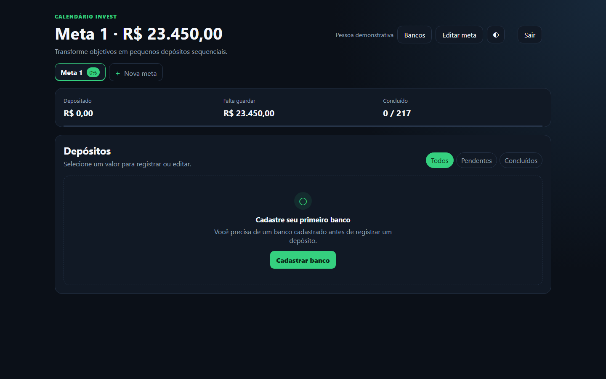
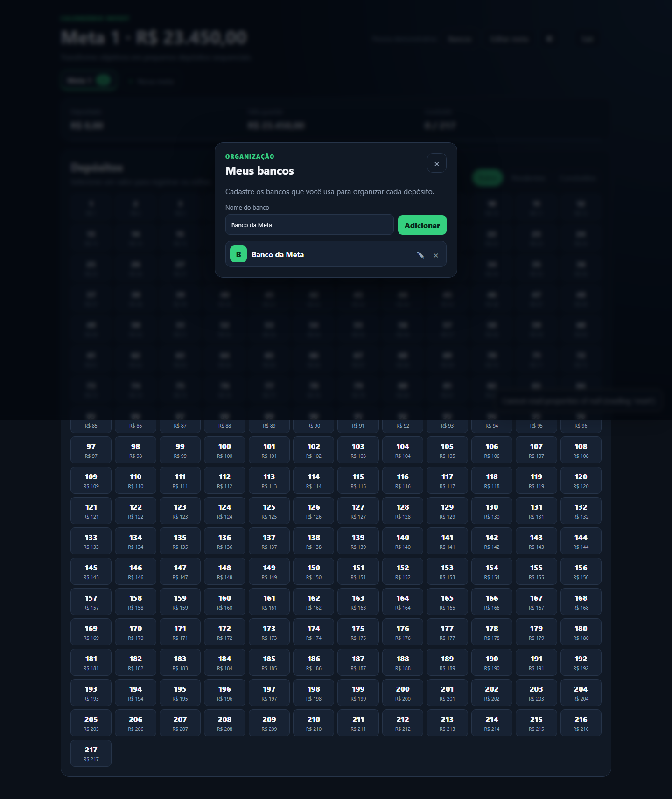
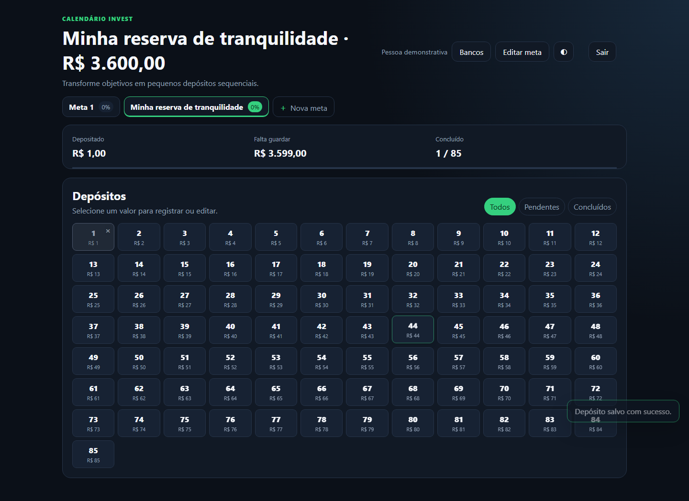

# Calendário Invest

Projeto implementado e documentado no repositório `aprendizado`, na branch
`calendario-invest`.

**Data da implementação:** 18 de novembro de 2026.

O código-fonte, as instruções, a documentação e as capturas de tela estão
disponíveis na branch indicada.

## Aplicação publicada

Acesse o projeto em [meta.wasxtech.com.br](https://meta.wasxtech.com.br).

O Calendário Invest transforma objetivos financeiros que parecem distantes em
uma sequência visual de pequenos depósitos. Cada pessoa possui sua própria
conta, cadastra metas e bancos e acompanha o progresso passo a passo.

## Fluxo visual

### 1. Acesso à conta

### 2. Cadastro individual

### 3. Painel inicial

### 4. Organização dos bancos

### 5. Criação de uma meta real

### 6. Objetivo transformado em pequenos passos

### 7. Registro de um depósito

### 8. Progresso visível

## Código-fonte

O desenvolvimento completo permanece na branch
[`calendario-invest`](https://github.com/Xavier-sa/aprendizado/tree/calendario-invest/calendario-invest),
preservada como branch de referência do projeto.
