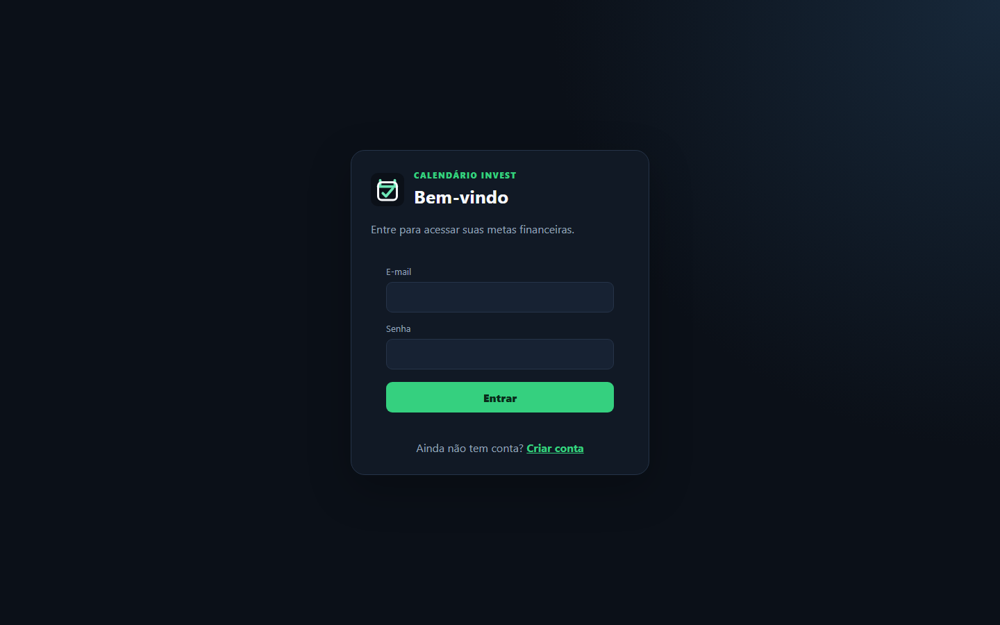
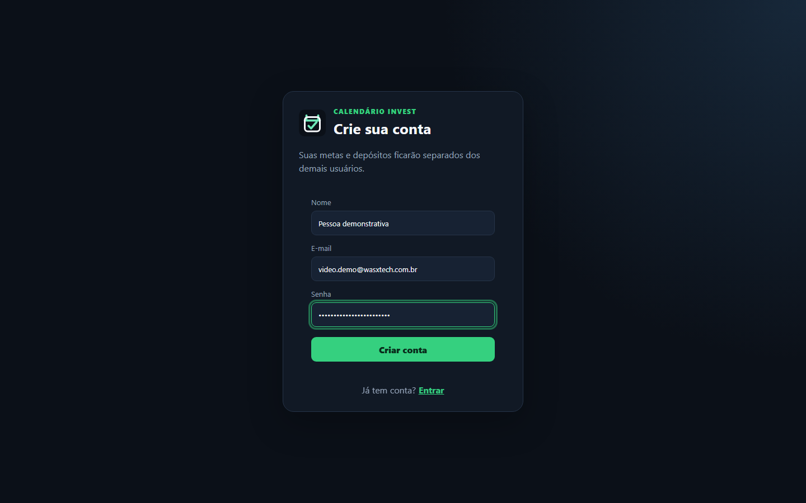
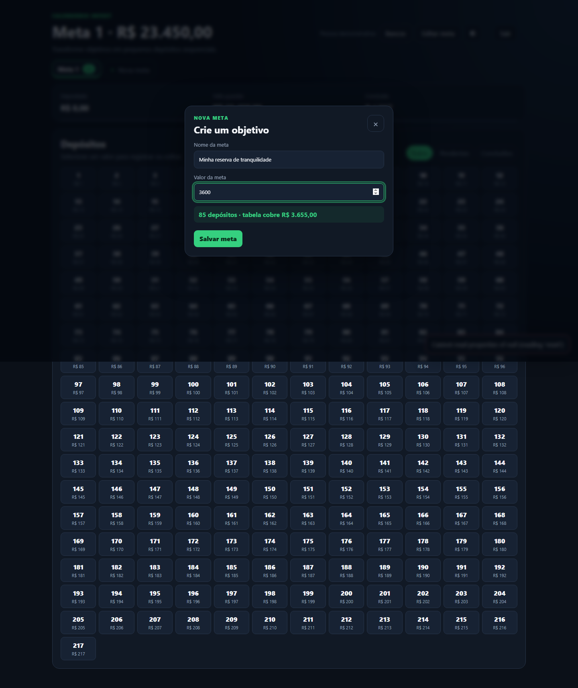

# WX Meta · Calendário Invest

O WX Meta ajuda você a transformar uma meta financeira distante em pequenos
passos que cabem no seu orçamento. Você escolhe quanto quer guardar, o
calendário sugere uma sequência de valores e cada depósito registrado torna
o progresso visível.

Nesta branch `main` fica a documentação de referência do projeto. A branch
[`calendario-invest`](https://github.com/Xavier-sa/aprendizado/tree/calendario-invest/calendario-invest)
contém o aplicativo Flask, os testes, o tutorial em vídeo e o workflow que
publica as atualizações na Vercel.

## Aplicação publicada

Abra a [home do WX Meta](https://meta.wasxtech.com.br/) para conhecer o
tutorial e use **Entrar** para acessar sua conta.

No painel, você pode criar e editar metas, organizar os bancos onde guarda
dinheiro e registrar depósitos manualmente. Seus dados ficam separados por
conta. O resumo mostra quanto você guardou, quanto falta e quais etapas foram
concluídas. As transferências acontecem no seu banco.

O acesso ao calendário é gratuito. A [página de apoio](https://meta.wasxtech.com.br/apoio)
oferece contribuição voluntária via Pix.

## Fluxo visual

As capturas abaixo mostram um exemplo de ponta a ponta com dados fictícios.
Algumas telas são de uma versão anterior da interface.

### 1. Acesso à conta

### 2. Cadastro individual

### 3. Painel inicial

### 4. Organização dos bancos

### 5. Criação de uma meta real

### 6. Objetivo transformado em pequenos passos

### 7. Registro de um depósito

### 8. Progresso visível

## Tutoriais e documentação

- [Vídeo do tutorial](https://github.com/Xavier-sa/aprendizado/blob/calendario-invest/calendario-invest/video-tutorial/output/wx-meta-tutorial.mp4)
- [Prévia da página de apoio](https://github.com/Xavier-sa/aprendizado/blob/calendario-invest/calendario-invest/docs/IMAGENS/apoio-wx-meta.png)
- [README do aplicativo e instruções de execução](https://github.com/Xavier-sa/aprendizado/blob/calendario-invest/calendario-invest/README.md)
- [Visão do projeto, atores e regras de negócio](https://github.com/Xavier-sa/aprendizado/blob/calendario-invest/calendario-invest/docs/PROJETO.md)
