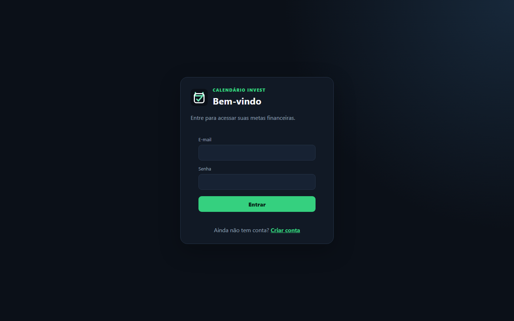
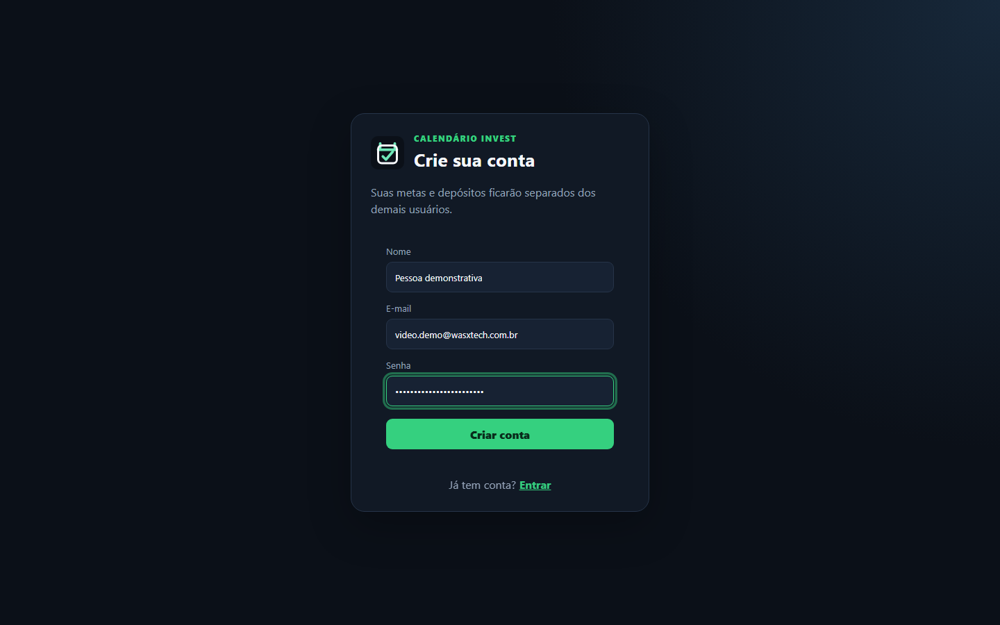
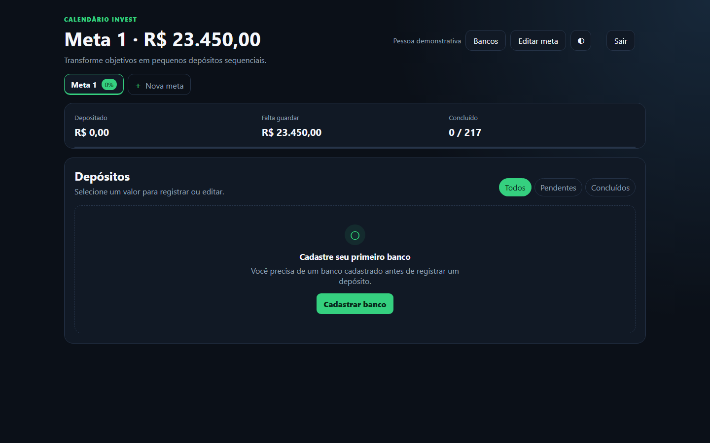
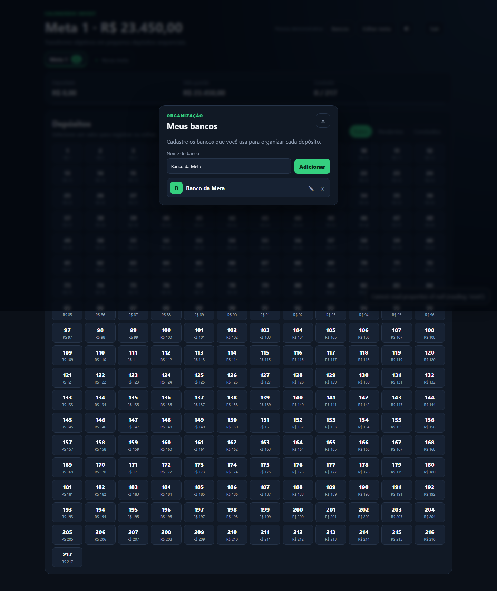
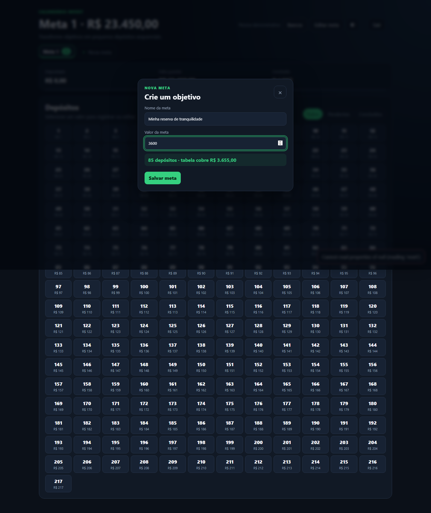
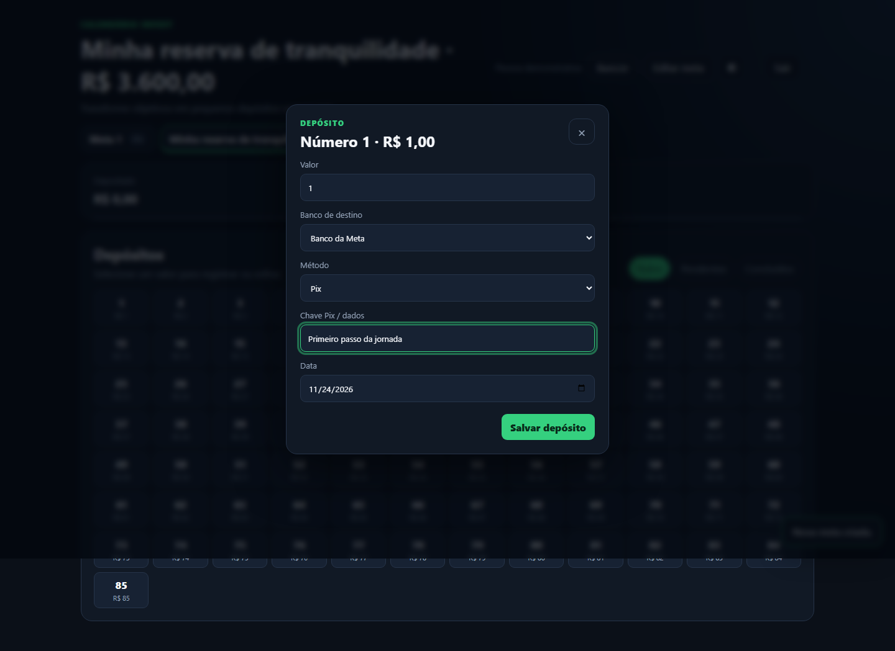
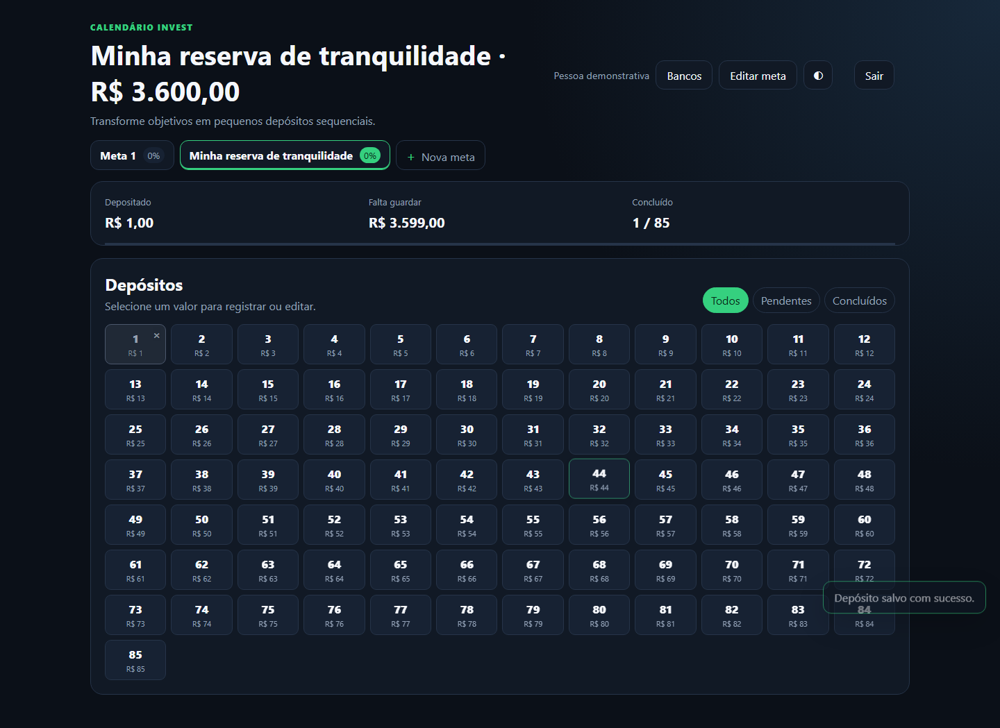

# Guia de produção do vídeo — Calendário Invest

Este material organiza a gravação de um vídeo curto e coerente sobre o
Calendário Invest. A ideia central é mostrar que objetivos aparentemente
distantes se tornam reais quando são transformados em ações pequenas, visíveis
e possíveis de concluir.

## Promessa do vídeo

> Você não precisa resolver uma meta grande de uma vez. Precisa enxergar e
> concluir o próximo passo.

O vídeo demonstra como uma meta de **R$ 3.600** vira uma tabela com **85
depósitos sequenciais** e como o primeiro depósito transforma intenção em
progresso real.

## Arquivos desta pasta

- [`ROTEIRO.md`](ROTEIRO.md): texto falado, cenas, avatar e marcações de tela;
- `capturas/`: telas reais, numeradas na ordem de edição;
- `gerar-capturas.mjs`: automação para recriar as imagens sem manter a conta de
  demonstração;
- este README: passo a passo para produzir e revisar o vídeo.

## Preparação

1. Separe o arquivo do seu avatar em PNG com fundo transparente.
2. Grave a voz em um ambiente silencioso ou use a voz do avatar.
3. Crie um projeto em 1920 × 1080 no editor de vídeo.
4. Importe o avatar, a narração e as oito capturas.
5. Use transições discretas de 200 a 350 ms; o conteúdo deve parecer simples,
   não apressado.
6. Mantenha o avatar ocupando aproximadamente 20% da largura da tela.
7. Posicione o avatar no lado oposto ao elemento que está sendo explicado.

## Sequência de cenas

### 1. Apresentar o problema



- Duração sugerida: 0:00–0:15.
- Avatar: canto inferior direito.
- Destaque: frase “metas distantes” em texto grande.
- Objetivo: gerar identificação antes de explicar o produto.

### 2. Mostrar que cada pessoa possui seu espaço



- Duração sugerida: 0:15–0:28.
- Avatar: canto inferior esquerdo.
- Destaque: nome, e-mail e a mensagem sobre separação dos dados.
- Objetivo: mostrar simplicidade e privacidade sem entrar em detalhes técnicos.

### 3. Começar com uma meta vazia



- Duração sugerida: 0:28–0:42.
- Avatar: canto inferior direito.
- Destaque: “Falta guardar” e o estado inicial.
- Objetivo: apresentar o ponto de partida real de qualquer objetivo.

### 4. Organizar onde o dinheiro será guardado



- Duração sugerida: 0:42–0:55.
- Avatar: canto inferior esquerdo.
- Destaque: banco cadastrado e ações de editar/remover.
- Objetivo: explicar que o aplicativo organiza, mas não movimenta dinheiro.

### 5. Trazer o objetivo para a realidade



- Duração sugerida: 0:55–1:15.
- Avatar: canto inferior direito.
- Destaque: nome da meta, valor de R$ 3.600 e prévia de 85 depósitos.
- Objetivo: apresentar a principal transformação do produto.

### 6. Revelar os pequenos passos


- Duração sugerida: 1:15–1:42.
- Avatar: canto superior direito, sem cobrir o resumo.
- Faça uma aproximação suave da linha “0 / 85” para os primeiros quadrados.
- Objetivo: entregar visualmente a promessa do gancho.

### 7. Registrar o primeiro passo



- Duração sugerida: 1:42–2:03.
- Avatar: canto inferior esquerdo.
- Destaque: valor, banco, método e data.
- Objetivo: mostrar que registrar progresso exige uma ação simples.

### 8. Mostrar o progresso real



- Duração sugerida: 2:03–2:35.
- Avatar: canto superior direito.
- Destaque: R$ 1 depositado, R$ 3.599 restantes e quadrado concluído.
- Objetivo: reforçar que um pequeno avanço já muda a percepção da meta.

## Orientação para o avatar

- Fale como um mentor próximo, não como um vendedor.
- Use pausas curtas depois de “próximo passo” e “progresso real”.
- Aponte para a interface apenas quando a cena tiver um elemento concreto.
- Evite ficar no centro; preserve a leitura dos valores e botões.
- Na conclusão, olhe para a câmera e deixe a aplicação visível ao fundo.

## Edição e acessibilidade

- Use legendas em português em todas as falas.
- Destaque no máximo uma frase por cena.
- Não use música mais alta que a narração.
- Evite flashes e movimentos bruscos.
- Mostre valores monetários por tempo suficiente para leitura.
- Não exiba e-mails, senhas ou dados bancários reais.

## Checklist antes de publicar

- [ ] O vídeo confirma a promessa nos primeiros 15 segundos.
- [ ] O avatar não cobre valores, botões ou formulários importantes.
- [ ] A meta de R$ 3.600 e os 85 passos estão legíveis.
- [ ] A diferença entre planejar e movimentar dinheiro está clara.
- [ ] As legendas foram revisadas.
- [ ] Nenhum dado real aparece nas telas.
- [ ] O fechamento possui apenas uma chamada para ação.

## Como recriar as capturas

Use uma conta exclusivamente demonstrativa. O script cria a conta, percorre o
fluxo e gera as imagens; a remoção da conta deve ser garantida ao final do
processo administrativo.

```powershell
$env:DEMO_EMAIL = "conta-demonstrativa@example.com"
$env:DEMO_PASSWORD = "uma-senha-temporaria-segura"
node docs\VIDEO-TUTORIAL\gerar-capturas.mjs
```

Nunca versione a senha usada na demonstração.
